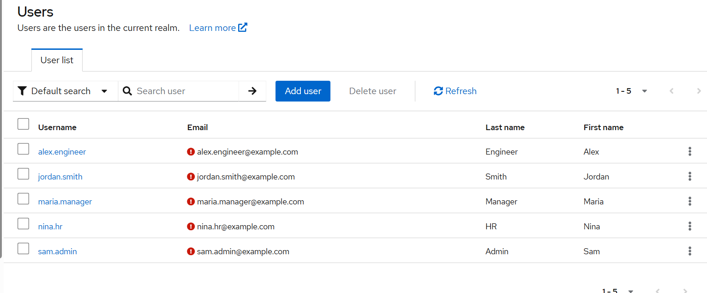
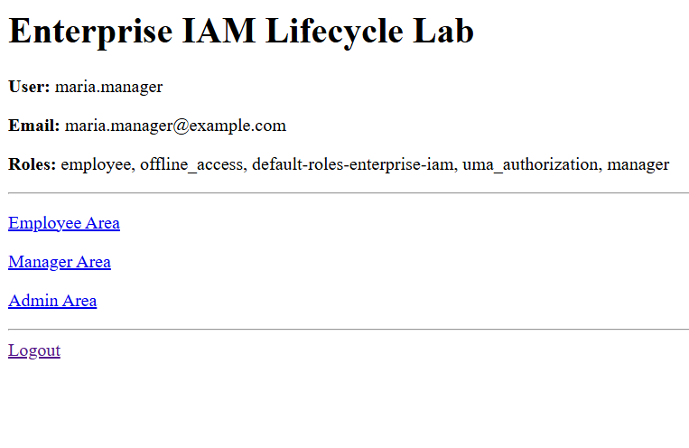
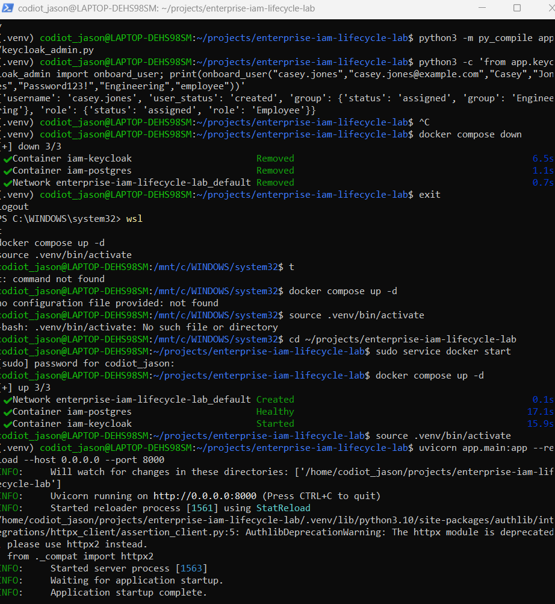
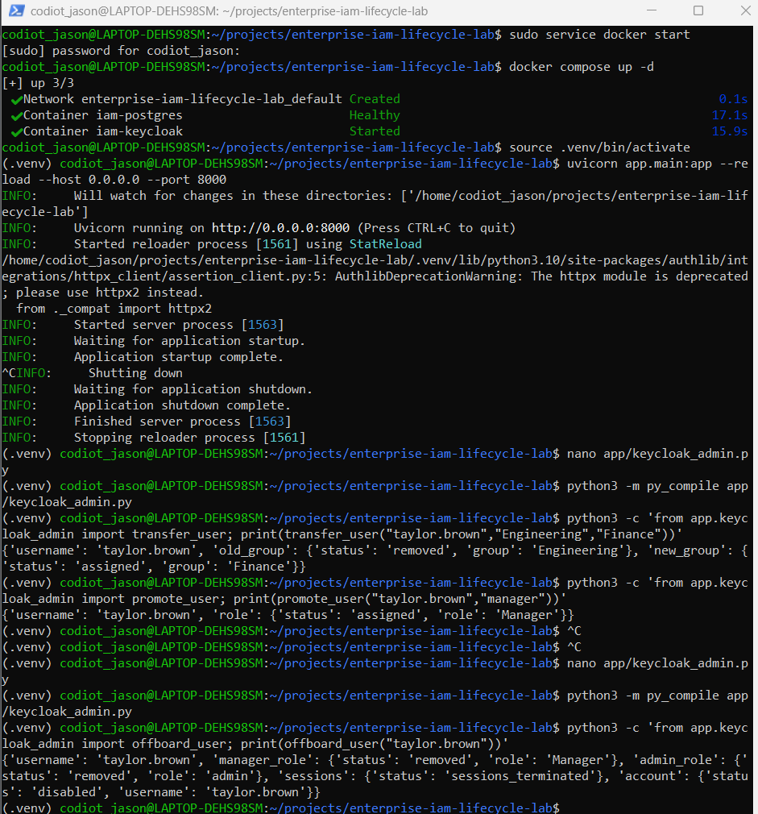

# Enterprise IAM Lifecycle Lab

A hands-on Identity and Access Management project that demonstrates workforce identity lifecycle management, OpenID Connect authentication, role-based access control, automated provisioning, Joiner-Mover-Leaver workflows, service-account integration, and audit logging.

## Project Overview

This lab simulates an enterprise IAM environment using:

- Keycloak
- FastAPI
- PostgreSQL
- Docker
- Python
- OAuth 2.0
- OpenID Connect
- JWT
- RBAC

The project demonstrates the full identity lifecycle:

**Joiner → Provisioning → Authentication → Authorization → Transfer → Role Change → Offboarding**

## Architecture

```mermaid
flowchart TD
    HR[HR / Workforce Event]
    AUTO[Python IAM Lifecycle Automation]
    KC[Keycloak Identity Provider]
    DB[(PostgreSQL)]
    APP[FastAPI Application]
    USER[Workforce User]
    AUDIT[Lifecycle Audit Log]

    HR --> AUTO
    AUTO -->|Admin API| KC
    AUTO --> AUDIT
    KC --> DB
    USER -->|OIDC Login| KC
    KC -->|Tokens| APP
    APP -->|RBAC Validation| USER
## Project Screenshots

### Keycloak Workforce Users



### OIDC Login and Role Display



### RBAC Enforcement



### Lifecycle Automation


```mermaid
flowchart TD
    HR[HR / Workforce Event]
    AUTO[Python IAM Automation]
    API[Keycloak Admin API]
    KC[Keycloak]
    DB[(PostgreSQL)]
    APP[FastAPI Application]
    AUTH[OIDC / OAuth 2.0]
    USERS[Workforce Users]
    RBAC[RBAC Authorization]
    JML[Joiner → Mover → Leaver]
    AUDIT[Lifecycle Audit Logging]

    HR --> AUTO
    AUTO --> API
    API --> KC

    KC --> DB
    KC --> APP

    APP --> AUTH
    AUTH --> USERS
    USERS --> RBAC

    JML --> AUTO
    AUTO --> AUDIT
```
